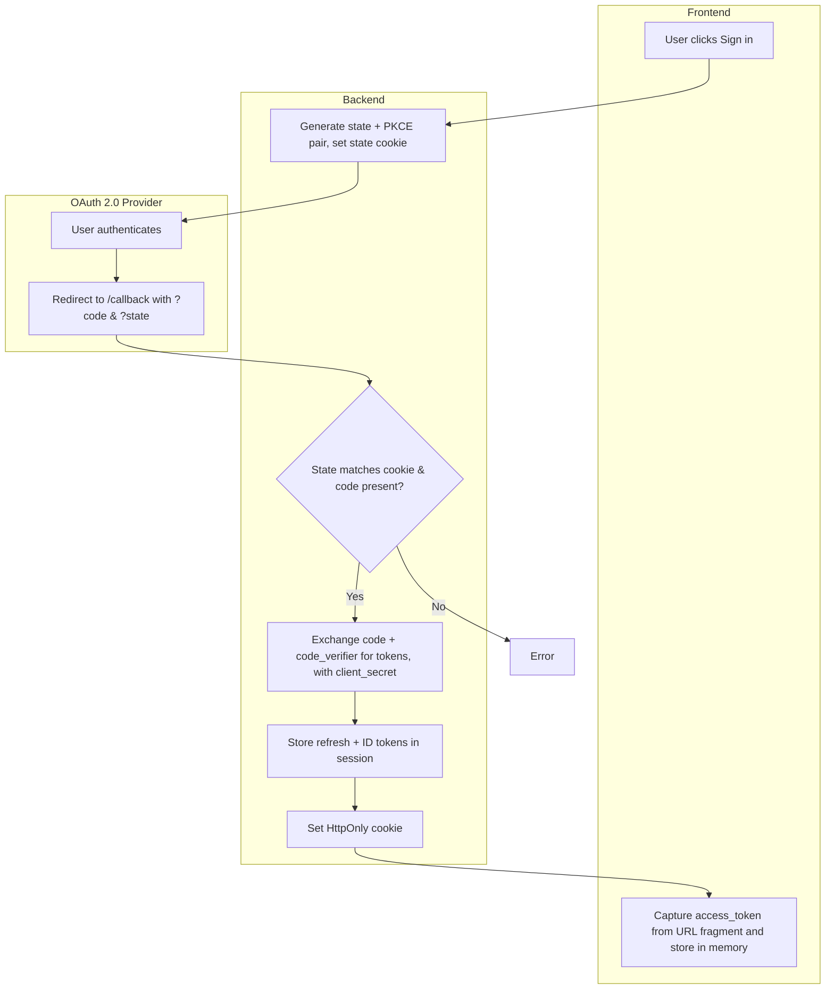
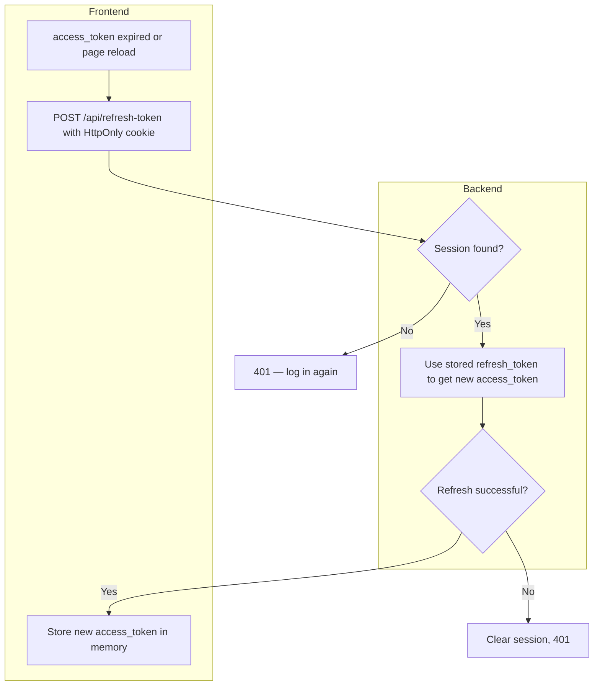
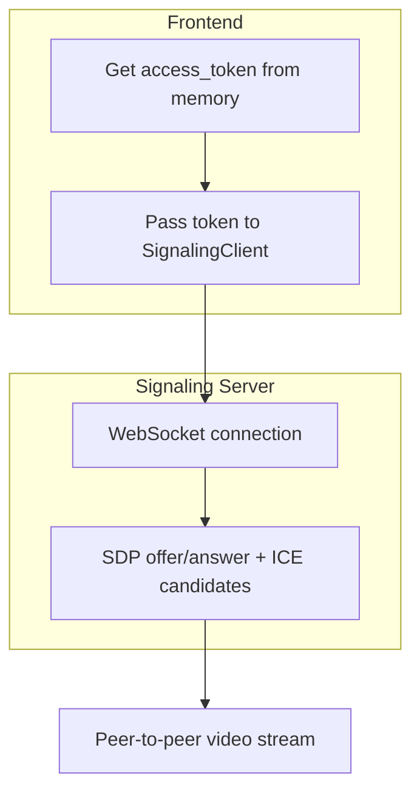

# Development Guide

This guide is the main reference for the main application's detailed architecture, endpoint
behavior, scripts, testing, and coding conventions. For setup instructions and a package map, see
[README.md](README.md).

For full coding conventions, see [`.github/copilot-instructions.md`](.github/copilot-instructions.md).

---

## Prerequisites

- **Node.js** ≥ 24.15
- **npm** ≥ 10 (ships with Node.js 24.15+)
- **OAuth 2.0 client ID and secret** from the [Axis Developer Portal](https://portal.connect.developer.axis.com/)

## Project Structure

```text
packages/
    backend/          Express OAuth 2.0 backend (login, token refresh, sessions)
    frontend/         React + Vite SPA (Fluent UI, WebRTC video streaming, direct API calls)
```

## Architecture

The backend is a minimal Express server (`packages/backend/src/index.ts` exports the app factory, `packages/backend/src/server.ts` is the entrypoint). It handles OAuth 2.0 login with the `client_secret` and keeps refresh and ID tokens in server-side sessions. The frontend stores only the `access_token` in memory and calls external APIs directly.

```text
┌─────────────────────────────────────────────────────────────────────┐
│  Frontend (React + Vite)                                            │
│                                                                     │
│  • Stores access_token in memory (never in browser storage)         │
│  • Calls ACC REST API, EdgeLink VAPIX, and WebRTC signaling directly│
│  • Uses HttpOnly cookie for session refresh only                    │
└───────┬──────────────────────┬──────────────────┬───────────────────┘
        │ cookie (auth only)   │ Bearer token     │ Bearer token
        ▼                      ▼                  ▼
┌─────────────────────────┐   ┌──────────────────┐   ┌──────────────────┐
│ Backend                 │   │ ACC REST API     │   │ EdgeLink VAPIX   │
│ (Express)               │   │ (direct)         │   │ (direct)         │
│                         │   └──────────────────┘   └──────────────────┘
│ • /auth/login           │                               │
│ • /callback             │                    ┌──────────────────┐
│ • /api/refresh-token    │                    │ WebRTC signaling │
│ • /api/session-info     │                    │ (direct)         │
│ • /api/csrf-token       │                    └──────────────────┘
│ • /auth/logout          │
│                         │
│ In-memory:              │
│ • Session store         │
│   (refresh +            │
│    ID token)            │
│ • CSRF state +          │
│   PKCE verifier         │
└─────────────────────────┘
```

**Key principle**: The backend keeps secrets and long-lived tokens (client secret, refresh token, ID token) on the server. The frontend only gets the short-lived access token and uses it to call Axis APIs directly. Because the access token lives in browser memory, an XSS bug could read it; the refresh and ID tokens never reach the browser.

### OAuth 2.0 Login Flow



---

### Token Refresh Flow



---

### WebRTC Signaling Flow



## Available Scripts

| Command | Description |
| --------- | ------------- |
| `npm run dev` | Start backend + frontend in watch mode |
| `npm run build` | Build all packages for production |
| `npm run test` | Run all tests (backend, frontend) |
| `npm run lint` | Type-check + Biome lint |
| `npm run format:fix` | Autoformat with Biome |
| `npm run type-check` | TypeScript strict check across all packages |

## Testing

Tests use [Vitest](https://vitest.dev/). Run them with:

```bash
# All tests
npm run test

# Backend only
npm run test --workspace packages/backend

# Frontend only
npm run test --workspace packages/frontend

# Watch mode (backend)
npm run test:watch --workspace packages/backend
```

### Test structure

```text
packages/backend/src/
    index.test.ts              Callback state cookie, PKCE + client authentication, CSRF-token issuance, refresh-token/logout CSRF enforcement, session-info decoding, rate limits, concurrent refresh, token response validation, response headers
    csrf.test.ts               CSRF token generation and constant-time validation

packages/frontend/src/
    auth/tokens.test.ts        getToken() caching, refresh, deduplication, error recovery, OAuth callback token parsing
    api/acc/index.test.ts      ACC query params (resourceGroupId, cursor, pageSize) and cursor pagination
    features/playback/utils/date-utils.test.ts   Default recording date selection
    features/edgelink-operations/utils/curlGenerator.test.ts   Shell quoting of copied cURL commands
```

### Adding tests

Follow existing patterns:

- Mock external dependencies (`fetch`, services) with `vi.mock()` / `vi.stubGlobal()`

## Coding Conventions (Summary)

Full rules are in [`.github/copilot-instructions.md`](.github/copilot-instructions.md). Key points:

- **TypeScript strict mode** everywhere — no `any`, use `unknown` + type guards
- **Explicit conditions** — `=== undefined` instead of `!value`
- **Braces always** — no braceless `if`/`return` statements
- **Backend**: `function` keyword for exports, arrow functions for inline callbacks
- **Frontend**: arrow functions everywhere
- **Imports**: grouped (Node built-ins → external → workspace → local)
- **No `console.log`** in production code — use `console.error` for exceptions, `console.warn` for degraded states
- **Readonly props** on all React component prop types

## Backend Design

The backend is intentionally minimal — `packages/backend/src/index.ts` exports a
`createApp()` factory and `packages/backend/src/server.ts` is the entrypoint.
It provides exactly seven endpoints:

| Endpoint | Method | Purpose |
| -------- | ------ | ------- |
| `/health` | GET | Health check |
| `/auth/login` | GET | Initiate OAuth 2.0 flow (generate CSRF state and PKCE pair, set browser-bound state cookie, redirect to authorization server) |
| `/callback` | GET | OAuth 2.0 callback (validate state against the state cookie, exchange code with `code_verifier`, store tokens server-side, redirect to frontend with `access_token` in URL fragment) |
| `/api/refresh-token` | POST | Token refresh (identify session via HttpOnly cookie, requires `X-CSRF-Token` header, return fresh `access_token`) |
| `/api/session-info` | GET | Return decoded ID token claims (sub, email, name, picture, organization) |
| `/api/csrf-token` | GET | Return the session-bound CSRF token required by other state-changing endpoints |
| `/auth/logout` | POST | Clear server-side session and cookie (requires `X-CSRF-Token` header) |

### Login security

Each login is protected in three ways:

- **Client secret** — the backend authenticates to the token endpoint with HTTP Basic auth, proving
    it is your registered app.
- **PKCE** — a one-time code verifier ties the authorization code to the login that requested it, so
    a stolen code cannot be used.
- **State cookie** — the `state` value is also stored in a short-lived HttpOnly cookie. `/callback`
    rejects a `state` that does not match, so a login can only finish in the browser that started it.

> [!NOTE]
> The OAuth flow is implemented by hand so it is easy to follow.

### Backend settings

| Variable | Default | Purpose |
| -------- | ------- | ------- |
| `PORT` | `3000` | Port the backend listens on |
| `OAUTH2_SCOPES` | `openid offline video_service` | Scopes requested at login. `offline` is required to get a refresh token |

### Before you go to production

This backend is a reference, kept small on purpose. Review these points before you build on it:

- **In-memory sessions.** Sessions live in the backend process. They are lost on restart and are not
    shared between instances. Use a shared store (for example Redis) if you run more than one instance.
    Each session lasts at most 24 hours from login.
- **Logout is local.** Logout deletes the server-side session but does not revoke the refresh token at
    the authorization server.
- **ID token is decoded, not verified.** `/api/session-info` reads claims from the ID token without
    checking its signature. This is allowed because the token comes straight from the token endpoint
    over TLS (OpenID Connect Core 3.1.3.7). Verify the signature if you get ID tokens any other way.
- **Rate limits are per IP and in memory.** Login and callback allow 30 requests per 15 minutes;
    session endpoints allow 300.
- **One refresh per session at a time.** Parallel refresh requests for the same session (for example
    from several tabs) share one call to the token endpoint, so a rotated refresh token is never reused.
- **Remote Operations shows the access token.** The request preview and copied cURL commands include
    the live Bearer token so developers can replay requests. Remove this from a real product.

## Contributing

See [CONTRIBUTING.md](CONTRIBUTING.md) for bug reports, feature requests, and pull request guidelines.
