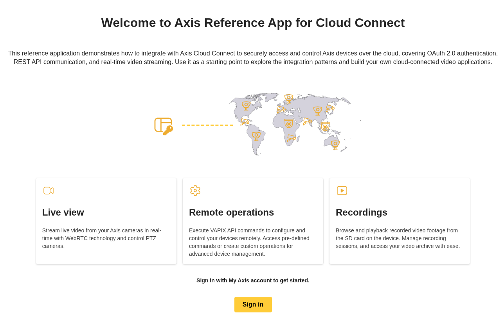

<!-- markdownlint-disable MD041 -->
*©2026 Axis Communications AB. AXIS COMMUNICATIONS, AXIS, ARTPEC and VAPIX are registered trademarks of Axis AB in various jurisdictions. All other trademarks are the property of their respective owners.*
<!-- markdownlint-enable MD041 -->

# Axis Cloud Connect Reference App

A reference and demo application for **Axis Developer Partners** integrating with [Axis Cloud Connect](https://whitepapers.axis.com/en-us/axis-cloud-connect#what-is-axis-cloud-connect) (ACC).


## Features

- **Live video streaming** via WebRTC, with PTZ click-to-center and scroll zoom
- **Device operations** through EdgeLink. EdgeLink allows authorized users to make HTTPS requests from anywhere to APIs on the local network through Cloud Connect API.
- **Recording playback** — today's recordings appear automatically when available, with calendar-based date selection
- **OAuth 2.0 login** — a small backend handles sign-in and keeps the client secret and refresh token on the server

## Prerequisites

- Node.js 24.15 or later
- An OAuth 2.0 client ID and client secret. If you don't have them, register an OAuth 2.0 client in the
    [Axis Developer Portal](https://portal.connect.developer.axis.com/).

## Getting Started

### 1. Clone this repository

```sh
git clone https://github.com/AxisCommunications/axis-cloud-connect-ref-app.git
cd axis-cloud-connect-ref-app
```

### 2. Install dependencies

```sh
npm install
```

### 3. Configure environment variables

Generate the required `.env.local` files:

```sh
npm run setup-environment
```

Then open `packages/backend/.env.local` and fill in your OAuth 2.0 client credentials:

```dotenv
OAUTH2_CLIENT_ID=your-client-id
OAUTH2_CLIENT_SECRET=your-client-secret
```

> [!NOTE]
> The app does not start until both values are set.

### 4. Start the application

```bash
npm run dev
```

| Service  | URL                                 |
| -------- | ----------------------------------- |
| Frontend | <http://localhost:5173>             |
| Backend  | <http://localhost:3000>             |

> [!TIP]
> For production builds, run `npm run build && npm run start`.

## Tech Stack

| Layer    | Technology                                                                                                                                                                     |
| -------- | ------------------------------                                                                                                                                                 |
| Frontend | [React](https://react.dev), [Vite](https://vite.dev), [Fluent UI](https://storybooks.fluentui.dev/react/?path=/docs/concepts-introduction--docs), [WebRTC](https://webrtc.org) |
| Backend  | [Express](https://expressjs.com), [OAuth 2.0](https://oauth.net/2)                                                                                                             |

## Architecture

The backend is a small Express server that handles OAuth 2.0 login. It keeps the `client_secret`,
refresh token, and ID token on the server and identifies the browser with an HttpOnly session
cookie. The frontend gets only a short-lived `access_token`, keeps it in memory, and calls Axis APIs
(Cloud Connect REST API, EdgeLink VAPIX, WebRTC signaling) directly.

### Overview

The frontend calls external Axis APIs **directly** with Bearer tokens. The backend exists only for
OAuth 2.0 login, token refresh, and server-side sessions.

```text
┌───────────────────────────────────────────────────────────┐
│   Frontend (React)                                        │
│                                                           │
│   access_token stored in memory                           │
│   ────────────────────────────────────────────────────────│
│   │ ACC REST API      → organizations, devices, resource groups │
│   │ EdgeLink VAPIX    → device commands (PTZ, audio, …)   │
│   │ WebRTC Signaling  → live & recorded video streams     │
└───┬───────────────────────────────────────────────────────┘
    │ HttpOnly cookie (auth only)
    ▼
┌────────────────────────────────┐
│  Backend (Express)             │  ← OAuth 2.0 login (holds client_secret)
│  /auth/login                   │     exchanges code for tokens
│  /callback                     │     stores refresh + ID tokens
│  /api/refresh-token            │     returns fresh access_token
│  /api/session-info             │     returns decoded ID token claims
│  /api/csrf-token               │     returns session-bound CSRF token
│  /auth/logout                  │     clears session
└────────────────────────────────┘
```

## Documentation

- [Development guide](./DEVELOPMENT.md) — detailed architecture, endpoint reference, scripts, tests, and coding conventions
- [Backend package](./packages/backend/README.md) — backend implementation scope and local design
- [Frontend package](./packages/frontend/README.md) — application features and workflows
- [Glossary](./docs/glossary.md) — Axis Cloud Connect and protocol terminology
- [Contributing](./CONTRIBUTING.md) — issue reports and pull requests

The development guide is the main reference for the main application's detailed architecture
and endpoint behavior. Package readmes cover package-specific context. Read
[Before you go to production](./DEVELOPMENT.md#before-you-go-to-production) before reusing the
backend in your own product.

## Project Structure

- **[backend](./packages/backend)** — Express OAuth 2.0 backend (login, token refresh, and session management)
- **[frontend](./packages/frontend)** — React + Vite SPA with Fluent UI components and WebRTC video streaming

## Development

See [DEVELOPMENT.md](./DEVELOPMENT.md) for available scripts, testing, and coding conventions.

See [CONTRIBUTING.md](./CONTRIBUTING.md) for bug reports, feature requests, and pull request guidelines.

## License

[MIT](./LICENSE)
