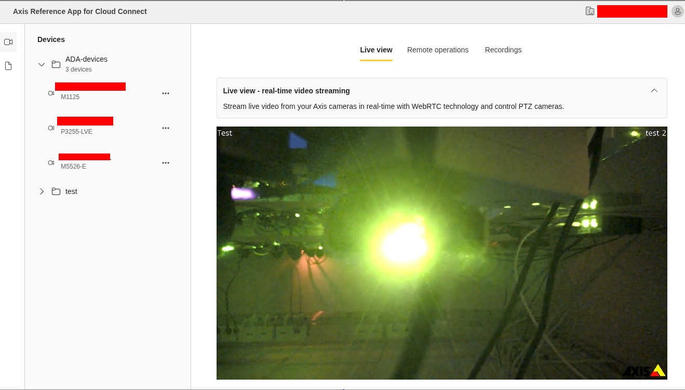

<!-- markdownlint-disable MD041 -->
*©2026 Axis Communications AB. AXIS COMMUNICATIONS, AXIS, ARTPEC and VAPIX are registered trademarks of Axis AB in various jurisdictions. All other trademarks are the property of their respective owners.*
<!-- markdownlint-enable MD041 -->

# Frontend Package

The React + Vite SPA for the Axis Cloud Connect Reference App, built with
[Fluent UI](https://react.fluentui.dev/) and organized by feature.

The frontend stores only the `access_token` in memory and makes **direct calls**
to external Axis APIs (ACC REST API, EdgeLink VAPIX, WebRTC signaling) using
Bearer tokens. It communicates with the backend only for OAuth 2.0 operations:
token refresh via HttpOnly session cookie and user info via `/api/session-info`.

## Features

Select a device from the device list, then use the tabs described below. The device list
shows the organization's resource groups; a group's devices are loaded when you expand it,
one page at a time (**Load more** fetches the next page).

### Live View

Live video streaming from the selected device using WebRTC via
[`axis-web-video-player`](https://github.com/AxisCommunications/axis-web-video-player).

Streaming starts automatically when a device is selected. On PTZ cameras, click the video
to center the view and scroll to zoom.

### Remote Operations

Execute device commands via **Axis EdgeLink**
VAPIX API. Open the **Remote Operations** tab.

#### Running a command

1. Under **Predefined commands**, select an action from the command menu — or choose
    **Custom operation** (under the **Custom** group) to define one manually.
2. In **Request Details**, review the endpoint path, HTTP method, content type, and
    body (body is shown only for `POST` requests). For a **Custom operation** these fields
    are editable; for predefined commands they are read-only. Fill in **Command Parameters**
    if the selected command supports them.
3. Click **Preview Request** to inspect the full payload before sending. The preview
    supports **Beautify** / **Show Raw** toggle and can be copied to clipboard or as a
    cURL command. The preview and the cURL command include your live access token, so
    don't share them.
4. Click **Send Request** and review the **Response** card (same formatting and copy
    options). Sending is disabled until all required parameters are filled in and valid.

### Recordings

Record and play back video from the selected device. Open the **Recordings** tab.

- **Start / stop recording** via VAPIX API.
- **List recordings** with a calendar view for date-based selection. Today's recordings are selected automatically when available.
- **Play recordings** with timeline controls.

## License

[MIT](../../LICENSE)
